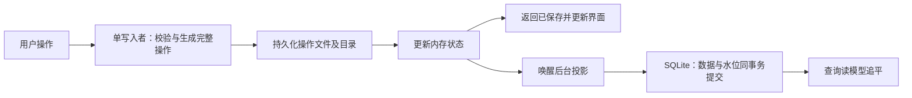

# 音乐库操作记录与异步 SQLite 投影方案

状态：设计和独立原型验证；尚未接入生产链路。现行持久化协议仍以 [目录协议](library-durability-protocol.md) 为准。

## 目标与边界

- 一次收藏或创建歌单的前台完成，定义为：用户点击后，完整操作记录及其目录项已按平台要求可靠同步，服务端返回成功，界面显示完成。目标是在明确的设备、库规模和测试条件下，端到端 P95 小于 50 ms。
- SQLite 是可重建的读模型。入库可以滞后，投影延迟另行统计；不能把界面乐观变化当成可靠保存，也不能把已保存当成 SQLite 已经追平。
- 同步所需的绑定、版本、前驱关系、原始正文和资源声明等仍必须可靠保存。现有资料、同步授权和恢复证据的语义不能因为缓存优化而丢失。

## 方案



1. 打开库时，取得库级跨进程写锁，验证持久化记录与必要的检查点，恢复内存状态并启动投影器。该写入者在运行期维护单调序号、最新业务状态和生成同步事实所需的完整状态。
2. 本地操作通过该写入者串行执行：校验对象和名称，生成包含完整业务变更及同步事实的不可变操作记录，携带稳定 operation ID、序号和完整性校验。LAN 入站、确认和本地写入必须共用同一个有序权威，不能从落后的 SQLite 推导版本或前驱。
3. 写临时文件并可靠同步，以文件系统支持的独占、原子方式发布不可变记录，再同步父目录。仅在目录同步成功后更新内存状态并返回「已保存」。发布后同步失败的结果可能不确定：保留同一 operation ID，进入待恢复状态，禁止简单地分配新 ID 重试。
4. 操作完成后通知后台按序投影；将业务行、已应用操作标识和投影水位放在同一个 SQLite 事务中。重复投递依 operation ID 与内容摘要判断；相同 ID 不同内容应报错。后台失败保留记录并重试，不阻止已经确认的文件保存。
5. 前台读到自己的新写入时，从内存权威状态或覆盖层读取；不能只读尚未追平的 SQLite。通知可合并，持久记录是待处理工作的来源；实现必须限制待处理内存和磁盘增长，定义超限时的背压，而不是无界堆积。
6. 启动时按已确认的有效记录恢复状态，并从 SQLite 的事务水位继续投影；SQLite 缺失时从经验证的检查点和后续记录重建。检查点可靠落盘且满足历史、资源、同步证据的覆盖规则后，才可考虑回收旧记录。SQLite 水位本身不授权回收日志。

这里的操作日志是每次一份不可变文件，并非所有操作追加到同一个文件。未来可以评估分段追加日志和批量同步，但它们需要单独证明持久化、并发与恢复语义；本次原型没有验证它们。

### 与现有同步语义的接合

目前本地编辑通过 SQLite 规划并捕获同步 mutation；它包含命名空间、绑定、原始正文、修订、作者序列和前驱等事实。不能仅保存「某首歌喜欢了」并以后从已经变化的 SQLite 状态补造这些字段。生产实现需要把完整 `LibraryBatch` / `FrozenMutation` 的生成移到串行权威状态中，或证明等价的其他方案。要覆盖绑定切换、入站同步交错、版本分配、墓碑、资源引用和原始正文，且保证已冻结正文不可变。

原型并未实现上述真实结构，也没有决定现有目录协议的最终迁移格式。新旧写入器必须通过明确的版本栅栏互斥；迁移应保留 v3 和历史恢复证据，使用可靠的原子切换并验证中断后的恢复。不得直接假定现有目录可以由新方案覆盖。

### 失败与恢复

| 阶段 | 可返回的结果及处理 |
| --- | --- |
| 发布前失败 | 未确认保存；临时文件不作为已提交记录。 |
| 发布后、目录同步确认前失败 | 结果未知，保留原 operation ID，重新验证和恢复；不能直接宣称未保存或生成新操作。 |
| 目录同步确认后、响应丢失 | 记录已保存；同 ID 重试返回同一结果，内容不一致则拒绝。 |
| SQLite 事务中断 | 数据和水位一起回滚，重启或重试后从持久记录继续。 |
| 记录损坏或链不连续 | 停止写入并保留证据，明确报告；不能用缓存或扫描结果悄悄覆盖。 |

文件锁只能约束遵守协议的进程，不能阻止其他程序直接修改文件。若移除现有每次写入时的验证，需要先确定外部篡改何时可见、如何检测并满足现有完整性测试；文件监听只能作为提示，不能作为完整性证明。根目录切换也需要终止旧写入者并阻止过期响应。平台文件系统必须支持并正确实现独占发布、锁及可靠同步；不满足时应明确降级或拒绝写入，不能声称相同的持久化保证。

## 独立原型验证

原型见 [journal_projection_spike.py](../scripts/perf/journal_projection_spike.py)，仅操作临时目录；它没有改写真实音乐库。每种操作各执行 300 次；先建立指定数量的 SQLite 合成歌曲行，之后从空操作历史开始。macOS 下操作文件和目录使用 `F_FULLFSYNC`，SQLite 使用 WAL 和 `synchronous=FULL`。前台计时覆盖校验、序列化、文件发布与同步、内存更新和通知，不含 React、Tauri IPC 和真实同步 mutation 的构造；后台延迟从保存确认到 SQLite 事务提交。

结果文件：[1000 首合成歌曲](verification/journal-spike-1000.json)、[10000 首合成歌曲](verification/journal-spike-10000.json)。这是同机独立原型，不是完整产品基准；合成行不代表真实的 1000 或 10000 份歌曲文件，且仅产生 600 份操作记录。与此前完整应用测量的 P95 不能直接比较。

| 合成歌曲行数 | 收藏确认 P95 | 创建歌单确认 P95 | SQLite 投影延迟 P95 |
| --- | ---: | ---: | ---: |
| 1000 | 10.969 ms | 10.989 ms | 1.197 ms |
| 10000 | 10.957 ms | 10.903 ms | 1.159 ms |

在 1000 行实验中，SQLite 锁定期间文件确认耗时 10.278 ms，投影延迟 128.511 ms；这是一次有意制造锁竞争的单次实验，不是锁竞争下的 P95。

原型还检查了进程在临时文件部分写入、文件同步、发布、目录同步和 SQLite 事务前后共七个位置中断后的恢复；同 ID 重试、记录篡改检测、SQLite 重建、跨进程写锁，以及 8 个并发写入的顺序和重复歌单名称。另有保持 SQLite 写锁约 100 ms 的实验，验证前台确认不必等待数据库追平。这些是进程中断测试，不是断电测试；不能证明硬件掉电、所有文件系统或生产协议的正确性。

复现：

```sh
python3 scripts/perf/journal_projection_spike.py --samples 300 --songs 1000 --report /tmp/echo-journal-spike.json
```

原型的后台失败重试、队列限流、操作发布后同步报错的完整处理、检查点与回收均未实现；启动还会逐个重新同步记录，历史很长时可能很慢。原型使用简化的名称和业务状态，也未验证非协作外部写入、跨平台或网络文件系统。

## 接入生产前的验收

1. 用真实 Rust 业务结构验证串行权威状态和现有 SQLite 规划生成的冻结 mutation 等价，覆盖本地和 LAN 同步交错、绑定、版本、资源、墓碑及重试。
2. 对同步、发布、目录同步、SQLite 事务及迁移的故障逐点注入；覆盖磁盘满、权限失败、超时、损坏、重启和掉电语义，检查不丢失已确认操作、不重复应用。
3. 实现有界通知、持续失败重试、背压和读己之写；验证长时间 SQLite 锁、积压以及数据库重建。
4. 实现并验证检查点、历史回收和完整性策略，覆盖长历史、恢复时间及外部修改，保留同步证据。
5. 在实际 Tauri 应用中，用真实目录和数据，从点击到可靠保存并完成界面更新测量 P50/P95/P99；分别统计 SQLite 投影延迟，覆盖 1000 和 10000 首真实记录及足够多的操作。只有实际端到端 P95 达标，才能宣布达到 50 ms 目标。
