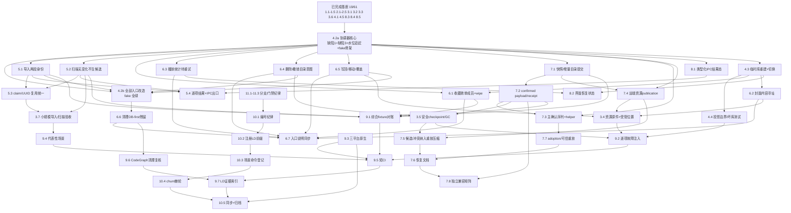

# 任务执行顺序 DAG（2026-10-25）

> **性质声明**：本文档是任务依赖关系分析与排期建议，**不是验收证据，不构成任何任务的完成证明**。
> 权威进度仍以 [tasks.md](../tasks.md) 勾选为准（当前 **19/61**）；行为是否满足规格由各任务的
> `验证：` 注记与本目录对应专题证据判定。本文档依据 `main` 已发布实现基线（见 design.md 证据声明）、
> tasks.md / handoff-20261025.md 的现状记录，以及对相关源码位置的只读取证整理而成。
> 文中所有代码行号仅作导航，执行前需用 CodeGraph 重新定位。
>
> 相关：本 change 的实现分支为 `codex/issue-72-library-first-durability`，HEAD `40eea4e`
> （自身声明 WIP，按 11.3 不作为现状基线）。

## 1. 阅读前提

分析本 DAG 前必须接受三个事实，否则会排出错误的顺序。

### 1.1 任务编号不是拓扑序

tasks.md 中存在多处编号倒挂：`3.4 / 3.5 / 3.7` 早于 `3.6`，`4.2 / 4.3 / 4.5` 早于 `4.4`，
`8.1 / 8.5` 早于 `8.2 / 8.3 / 8.4`。这些是历史重排的痕迹，**不能按编号顺序读依赖**。
本文档一律按语义依赖建边。

### 1.2 4.2 是伞形枢纽，且与三个任务构成环

4.2（应用提交协调器）同时是 5.1、6.1、6.3、6.4、7.1、7.3、7.4、8.1 的前置；
但 4.2 自身的验收条件"绝无用户 DB-first 写入"又要求 5.1（`recover/mod.rs::commit_record`）、
6.4（`delete.rs` / `restore.rs`）、6.5（写回路径）先改完。**这是一个真实的环。**

同样的伞形问题出现在 3.4（资源原件与受管位置）和 3.5（安全 checkpoint / GC）上。

### 1.3 已勾选项不可信为终态

8.3 / 8.4 / 8.5 虽已勾选，但 8.4 的验证注记自陈"后续 IPC/UI 修改仍须重跑受影响检查"。
8.1 / 8.2 落地后必须重跑前端五项检查。这类关系是**再验证边**，不是构建边，
排期时容易漏。

## 2. 结构性发现

以下八条是本次分析的主要结论，每条都改变了任务的排期或拆分方式。

### F1. 4.2 必须拆成 4.2a 与 4.2b

4.2 的验收要求两层不变量同时成立：

- 协调器核心：缺陷 1（歌单重试丢稳定操作身份）、缺陷 3（保留成员被无条件删除）已修，
  水位追赶成立，C1 投影失败 / C2 成功后追赶使 C1 事实进入投影。
- 全局入口：`recover/mod.rs`、`trash.rs`、`delete.rs`、`restore.rs`、`continuation.rs`
  及四处 per-operation `project` 闭包全部改到协调器，"绝无 DB-first 写入"的可控次序 fake 全绿。

第二层依赖 5.1 / 6.4 / 6.5 完成，直接以 4.2 作为它们的前置会死锁。
**建议把 4.2 拆为**：

- **4.2a**：修缺陷 1 + 缺陷 3，落实"从 SQLite 已记录投影水位出发按目录链顺序幂等追赶"，
  建立可控次序 fake 骨架（先只覆盖已接入的入口：喜欢、歌单、成员、封面、播放记录）。
  4.2a 完成后即可放行 5.1 / 5.2 / 6.1 / 6.3 / 6.4 / 6.5 / 7.1 / 7.3 / 7.4 / 8.1 / 4.3。
- **4.2b**：5.1 / 6.4 / 6.5 完成后，把 fake 扩展到全部入口并全绿，才勾选 4.2。

拆分后 6.6（删除 DB-first materializer）与 9.6（CodeGraph 清理复核）都以 4.2b 为前置。

### F2. 3.4 是三个任务的汇总项，不应独立排期

剩余工作分散在三处，且分别属于不同任务：

| 3.4 的验收片段 | 实际归属 | 现状 |
| --- | --- | --- |
| 用户资源原件位置持久化 | **6.2**（封面内容寻址） | `write_asset` → `echo/assets/<hash>` 已存在，歌单封面已用；艺术家封面仍只写 cache key（`catalog.rs:161-199`） |
| 写回前保留旧字节与替换意图 | **6.5** | 写回 / 移动 / 覆盖字段写路径在 0.1.0 尚不存在（handoff 记录） |
| 实际受管版本位置（owner/version） | **7.4**（远端资源 publication） | 目前只在 SQLite `sync_remote_resource_locations`，未落目录 state |

**建议**：3.4 作为 6.2 + 6.5 + 7.4 的汇总关闭项，不在关键路径上单独占位；
若 6.5 因产品缺口被移出本 change，3.4 的范围须同步收缩并在 tasks.md 记录。

### F3. 3.5 的生产者尚不存在，必须排在 6.4 与 7.2 之后

`checkpoint.rs::cleanup_covered` 已实现"receipt + anchor 引用保护 + 证明阶段先于首次删除"
（`gc_performance.rs` 有完整故障注入覆盖），但 LD-02 / 3.5 规格要求的引用图还包括：

- 待确认候选、快照、冲突 → 由 **7.1 / 7.2** 产生
- 删除意图 → 由 **6.4** 产生
- 未完成发布资源 → 由 **7.4 / 7.5** 产生

即 **3.5 与 7.5 互为依赖**（3.5 提供压缩，7.5 把候选终结纳入重放/压缩），
必须共同设计。单独先做 3.5 会做出一个引用图不完整的 GC。

### F4. 6.5 被产品缺口卡住，需要显式决策

handoff 明确："写回 / 移动 / 覆盖字段的写路径在 0.1.0 尚不存在，旧字节保护与覆盖清理无法验证。"
这条同时卡住 3.4 的第二半与 6.6 的清理完整性（`write_record_guarded` 的最后调用方 `trash.rs:366`
也依赖"提交才切换引用"的语义）。
**排期前需要决策**：在本 change 内新建该写路径，或把 6.5 + 3.4 的对应部分拆到后续 change。

### F5. 5.4 有隐藏的前端依赖

歌词失败要逐条报告给界面，必须改 `ipc/dto.rs:465-508` 的 `From<ImportOutcome> for ImportResultDto`
（当前用 `..` 丢弃 `lyrics` 字段），即 **5.4 依赖 8.1**。这是唯一一条"Core 任务 → IPC 任务"的边，
按编号顺序排期时会漏掉。

### F6. 5.2 的"无变化不生候选"可独立先修

`scan/durable.rs:211-221` 的业务字段未变早退分支仍走 `project()`，触发
`statements.rs:129 enqueue_object_snapshot` → `sync/sync.rs:134 enqueue_sync_in_root_with_resources`，
后者计算 digest 但不去重，无条件插入 `sync_mutations` / `sync_outbox` 并推进
`sync_local_highwater.local_revision`，违反 `local-library` delta 的"无变化重扫不增加 revision、
播放计数或同步候选"。

该修复（早退分支不触发投影）与 4.2 的"per-operation 闭包只是触发点"部分重叠但更小，
**可在 4.2a 之前或并行先做**，用于缩小 5.2 的缺口。

### F7. 9.3 是归档硬门禁，与短 CI 范围直接冲突

handoff 明确"三平台原生验证未做，9.3 / 10.5 的归档前置条件因此不成立"，
而 design.md D8 与 9.5 又规定"三平台原生验证属于整体发布或后续独立验收，不作为短 CI 门槛"。
**这是本 change 最大的未决决策**：若不解决，10.5（同步 delta + 归档）永远无法完成。
可选：把 9.3 明确移交独立 change 并在 proposal 中记录范围收缩，或接受归档延后。

### F8. 10.1 / 10.2 越晚做越危险

`library-durability` 前缀尚未注册到 `scripts/verify/spec-scenarios.mjs` 的 `AREA_PREFIX`，
`docs/traceability.md` 无对应段。10.1 的编号纪律（新 requirement / scenario 一律追加到末尾）
一旦被违反会重排既有稳定 ID（如 `PLL-R07-S05`），使既有验收命令指向错误场景。
**这两项无代码前置，应立即做**，且必须在 10.3 生成 manifest 之前。

## 3. 依赖 DAG



### 3.1 边的依据

每条边只记录"为什么必须等待"，便于后续核对。

| 边 | 依据 |
| --- | --- |
| BASE → 4.2a | 4.1（顺序 migration + 水位）、4.5（typed recovery key）、2.2（`LibraryDurabilityPort`）、3.1–3.3（提交 / 材料化 / 幂等重放）已就绪 |
| 4.2a → 5.1 / 5.2 | 导入与扫描的 per-operation `project` 闭包须改为只作触发点 |
| 4.2a → 6.1 | 收藏 / 歌单 / 成员统一走协调器（`local_library_edit.rs::plan_library_change` 已提供样板） |
| 4.2a → 6.3 | 播放统计待重试队列须挂在协调器结果态上 |
| 4.2a → 6.4 | 删除 / 撤销的本机意图与最终集合须先于 SQL 提交 |
| 4.2a → 6.5 | 写回须"旧字节保留 → 提交才切换引用" |
| 4.2a → 7.1 | 快照 / 增量须成为 Core 目录提交用例 |
| 4.2a → 7.3 | 主确认序列"规划 → 提交 → 投影"须抽成共用 helper |
| 4.2a → 7.4 | publication 须保存目录位置声明与完成凭据 |
| 4.2a → 8.1 | IPC 结果态（未保存 / 待恢复 / 待投影 / 完成 / 部分恢复）由协调器状态派生 |
| 4.2a → 4.3 | 重建须从已记录投影水位出发，不能另起一套投影 |
| 4.3 → 4.4 | 投影边界 / 坏库 / 只读 / commit 失败测试需要重建路径可跑 |
| 4.3 → 6.1 | wipe round-trip 需"新建空库 → 重建 → 比对" |
| 4.3 → 6.2 | "清空全部应用缓存后离线恢复"需重建 |
| 4.3 → 8.2 | 界面呈现"未解析记录 / 待投影"依赖重建产出的 partial 报告 |
| 5.1 → 5.3 | claim / UUID 复用须先有两段身份的 claim 语义 |
| 5.2 → 5.3 | 同上 |
| 5.1 → 5.4 | 逐项结果需区分"预留 claim"与"提交 Song" |
| 5.2 → 5.4 | 重扫侧逐文件诊断须有出口 |
| **8.1 → 5.4** | **歌词失败需经 `ImportResultDto` 才能到界面**（见 F5） |
| 5.2 → 3.7 | 小规模扫描验收含"无变化不生候选" |
| 5.3 → 3.7 | 双 worker / watcher 抢先 / 取消须先统一身份 |
| 6.1 / 6.2 / 6.3 / 6.4 / 6.5 / 6.6 → 6.7 | 各入口持久化 / 错误说明汇总同步 |
| 6.2 → 3.4 | 用户资源原件位置持久化（见 F2） |
| 6.5 → 3.4 | 写回前保留旧字节与替换意图 |
| 7.4 → 3.4 | 受管版本实际库内位置 |
| 7.1 → 7.2 | confirmed payload / receipt / alias 持久化在快照增量之后 |
| 7.2 → 7.3 | 误确认语义修复是主确认序列的前提 |
| 7.3 → 7.7 | adoption 在"规划 → 提交 → 投影"helper 之上 |
| 7.2 → 3.5 | GC 引用图须保护候选 / 快照 / 冲突（见 F3） |
| 6.4 → 3.5 | GC 引用图须保护删除意图 |
| 7.1 → 7.4 | 资源 publication 挂在快照 / 增量之后 |
| 7.4 → 7.5 | 候选终结 / 冲突原件纳入重放 |
| 3.5 → 7.5 | 压缩（与 3.5 互为依赖，须共同设计） |
| 7.5 → 7.6 | 恢复文档须反映最终重放 / 压缩语义 |
| 7.7 → 7.6 | 同上 |
| 7.2 → 7.8 | 兼容矩阵需 confirmed payload 稳定 |
| 7.6 → 7.8 | 矩阵结果写入协议 / 恢复文档 |
| 6.3 → 8.2 | 统计错误不中断播放但可查看 |
| **5.1 → 4.2b** | **4.2b 要求无 DB-first 写入，`recover/mod.rs` 属 5.1**（回边，见 F1） |
| **6.4 → 4.2b** | `delete.rs` / `restore.rs` DB-first 残留属 6.4 |
| **6.5 → 4.2b** | 写回路径须受协调器控制 |
| 4.2b → 6.6 | 删除 materializer 前须确认无第二条可写入口 |
| 6.6 → 9.6 | 清理复核基于已清理状态 |
| 3.7 → 9.4 | 代表性场景验证复用小规模导入 / 扫描结论 |
| 5.1 / 5.2 / 6.1 / 7.1 / 7.2 → 9.1 | 综合 fixture 混合本地导入 / 扫描 / 喜欢 / 歌单 / 封面 / 统计 / alias / 删除 / LAN |
| 3.4 / 3.5 / 4.4 → 9.2 | 逐项故障注入覆盖资源 / GC / SQLite commit |
| 9.1 / 9.2 / 9.3 / 9.4 → 9.5 | 短 CI 汇总 |
| 9.5 / 9.6 → 9.7 | LD-01…LD-10 证据索引 |
| 11.1 → 10.1 | 分支纪律先行（PR 在同步与归档之后） |
| 10.1 → 10.2 | 编号纪律先于前缀注册 |
| 10.2 → 10.3 | `AREA_PREFIX` 必须先有 `LD` 才能生成 manifest |
| 10.3 → 10.4 | churn 棘轮基于新生成的 manifest |
| 10.4 → 10.5 | 对账通过才同步 / 归档 |
| **9.3 → 10.5** | **三平台原生是归档前置（见 F7）** |
| 9.7 → 10.5 | 证据索引完成才归档 |

## 4. 关键路径与并行轨道

### 4.1 关键路径

**主路径（10 节点）**：

```
4.2a → 7.1 → 7.2 → 7.3 → 7.7 → 7.6 → 9.2 → 9.5 → 9.7 → 10.5
```

LAN 链最长，因为 7.x 既要等 4.2a，内部又有 7.1→7.2→7.3→7.7 的严格顺序，
且 7.6 要等 7.5 与 7.7 两边。

**次长路径（9 节点）**：

```
4.2a → 6.4 → 3.5 → 7.5 → 7.6 → 9.2 → 9.5 → 9.7 → 10.5
```

**第三路径（6 节点）**：

```
4.2a → 5.1 → 5.3 → 3.7 → 9.4 → 9.5
```

### 4.2 4.2a 完成后的四条并行轨道

| 轨道 | 内容 | 汇入点 |
| --- | --- | --- |
| **A 本地摄入** | 5.1 → 5.2 → 5.3 → 3.7；5.4（等 8.1） | 9.4 |
| **B 本地编辑** | 6.4 → 3.5；6.1 / 6.2（等 4.3）；6.3 / 6.5 → 6.6 → 6.7；3.4（汇总 6.2+6.5+7.4） | 9.1、9.2、9.6 |
| **C LAN** | 7.1 → 7.2 → {7.3→7.7, 7.4→7.5} → 7.6 → 7.8 | 9.1、9.2 |
| **D IPC/UI** | 8.1 → 8.2（+ 8.3/8.4/8.5 重跑） | 5.4、6.7 |

轨道 B 与 C 在 **3.5 ↔ 7.5** 上耦合，需两轨道协同；
轨道 D 与轨道 A 在 **8.1 → 5.4** 上耦合。

## 5. 排期波次

按依赖深度分批，每波结束时跑本波相关验证，不跨波引用未执行结果。

### 波次 0：无代码前置（可立即启动）

| 项 | 动作 | 完成判据 |
| --- | --- | --- |
| 11.1 / 11.2 / 11.3 | 分支纪律持续生效 | `git log --oneline main..HEAD` 只含本 issue 提交；`main` 门禁不因本 change 变红 |
| 10.1 | 复核编号纪律 | `node scripts/verify/reconcile-scenarios.mjs` 证明既有稳定 ID 无位移 |
| 10.2 | 注册 `library-durability` → `LD`，补 `docs/traceability.md` | 三方计数一致 |
| 4.2a·缺陷 1 | `library_durability_playlist_create_retry_after_saved_pending_keeps_operation_identity` 由 `#[ignore]` 转 RED → GREEN | 移除 ignore 标记 |
| 4.2a·缺陷 3 | `retained.rs:168-172` 保留成员不再无条件删除 | 依赖补齐后自动关联 |
| 5.2·F6 | 早退分支不触发投影 | 无变化重扫不增加 revision / 候选 |

### 波次 1：协调器核心

4.2a：水位追赶不变量 + 可控次序 fake 骨架（覆盖已接入入口）。
**出口**：`cargo test -p echo-core library_durability` 在受控次序下无 DB-first 写入。

### 波次 2：四轨道并行

- A：5.1 → 5.2（收尾）→ 5.3 → 3.7
- B：4.3 → 6.1 → 6.2 → 6.3 → 6.4 → 3.5；6.5（依赖 F4 决策）；6.6
- C：7.1 → 7.2 → 7.3 → 7.4 → 7.7 → 7.5 → 7.6 → 7.8
- D：8.1 → 8.2；回填 5.4；重跑 8.3 / 8.4 / 8.5

### 波次 3：汇总与验证

3.4（汇总）→ 6.7 → 4.2b → 9.1 → 9.2 → 9.4 → 9.3 → 9.5 → 9.6 → 9.7

### 波次 4：归档

10.3 → 10.4 → 10.5（**受 F7 决策阻塞**）

## 6. 需要显式决策的四个问题

| # | 问题 | 影响 | 建议 |
| --- | --- | --- | --- |
| Q1 | 4.2 是否按 F1 拆分 | 决定 5.1 / 6.4 / 6.5 能否开工 | 拆分；tasks.md 增加 4.2a / 4.2b 两行并保留原验收文本 |
| Q2 | 6.5 写回路径是否本 change 内建设 | 决定 3.4、6.6、4.2b 范围 | 若 0.1.0 不排，把 6.5 与 3.4 对应部分移出并记录范围收缩 |
| Q3 | 9.3 三平台原生由谁承担 | 决定 10.5 归档能否完成 | 移交独立 change 并在 proposal 记录；否则归档延后 |
| Q4 | 3.4 / 3.5 是否改为汇总项 | 决定关键路径长度与 owner 清晰度 | 3.4 改汇总（F2）；3.5 保留但标注与 7.5 协同（F3） |

## 7. 待确认与取证限制

- 本 DAG 的边来自 tasks.md 验收文本、handoff-20261025.md 的缺口清单与源码位置核对，
  **未通过编译或测试执行验证**。任何"该任务可并行"的结论都不代表其验证已通过。
- `MAX_ACTIVE = 256`（`durability.rs:29`）是当前活跃 transaction 目录上限，
  3.5 的"链长度与活跃窗口而非总历史成正比"需在压缩落地后重新核对，本文档未测量。
- 性能相关结论（10k 量级、IO 观察）属 3.7 / 9.4 范围，本文档不涉及。
- 若后续修订 tasks.md 的勾选或范围，本 DAG 需重新核对 F1 / F2 / F3 / F7 四条结构性结论是否仍成立。
