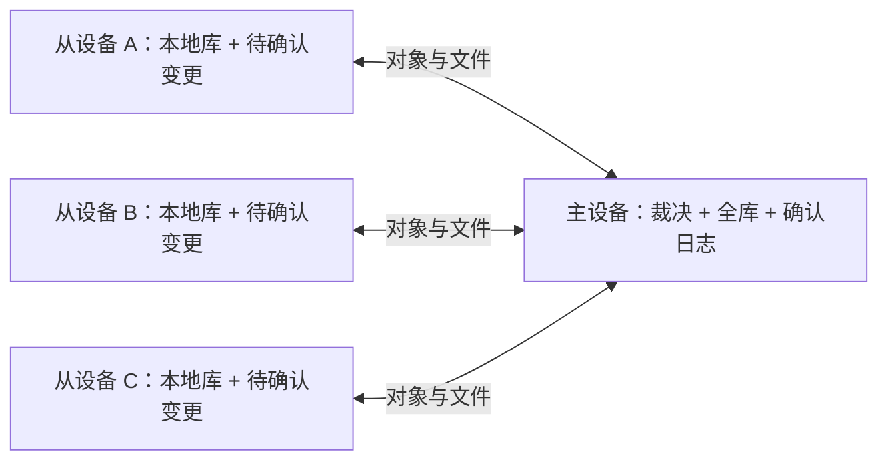

# Design

## Context

动机与范围见 proposal.md。用户确认：整个音乐库双向同步，一台主设备，其他设备作为从设备加入。主从描述连接与裁决职责，不限制从设备的编辑能力。

当前已具备 Rust Core、SQLite 单写入执行器、稳定歌曲/歌单/成员 UUID、BLAKE3、portable records、设备身份、outbox、墓碑和 operation journal，但没有网络同步引擎。

研究证据：

| 当前实现 | 可复用点与缺口 |
| --- | --- |
| `crates/echo-core/src/domain/library.rs` | manifest、记录类型和安全相对路径；需要新增网络协议封套，不能把本机根路径当库身份 |
| `infrastructure/sqlite/sync.rs` | 本地事务内预写完整快照；revision 由对象 outbox MAX+1 生成，不能比较不同设备，不能清空后再从 1 开始 |
| migrations `0005` / `0006` | sync_state/outbox/tombstone/device_state 基础；没有网络 inbox、主日志或逐设备确认 |
| `application/continuation.rs`、`portable.rs` | 资料库接续与恢复；不是已证明可用于实时远端冲突应用的入口 |
| `runtime/player/recorder.rs` | 按设备计数材料化播放统计；需补充事务内变更通知/同步捕获，不能假定所有数据已完整进入 outbox |
| `application/delete.rs` | 已有 10 秒撤销窗口，并在 PendingDelete 时写 portable 墓碑；该临时事实不能直接当作主确认的最终删除 |
| `scripts/verify/checks/task-13.8.mjs`、App scope guard | 仍禁止网络与同步入口；需将断言改成默认关闭和 WebView 无网络直连 |

ROADMAP 已明确局域网优先；PRODUCT、DESIGN、CODE_STANDARDS 的部分二期条款仍写 S3/WebDAV，实施第一步统一相关条款。本方案保留其本地优先、稳定 UUID、控制面可恢复、Core 与播放器分离的约束。

## Goals / Non-Goals

**Goals:** 一个主库与多个完整本地副本最终一致；离线修改可恢复；传输不依赖 UI；网络和进程中断不丢失已确认变更；多从设备互相传播；同步不阻塞已落盘歌曲的播放。

**Non-Goals:** 多主、自动选主、从设备直连互传、后台系统守护进程、不同库的自动合并、流式播放、远端连接器和新增编辑能力。首版默认每个应用实例仅为活动资料库运行一个同步角色；其他库停止会话但保留绑定。主设备停机时不选新主，其他设备继续离线使用。

## Decisions

### 1. 星形拓扑与权限



每份资料库只有一个主绑定，标识为 `(library_id, authority_id, epoch)`，与 IP、目录和设备名称无关。主设备自身修改也经过同一确认管道。各设备的 SQLite、路径映射、登录凭据、播放队列与偏好各自独立。

主设备持有设备授权列表：从设备默认可同步全库及提交编辑，但只有主设备可配对/撤销设备、开关服务。授权始终限定到一个 library_id，不能凭某个文件哈希读取其他库内容。

选择中心汇聚是因为用户明确主从拓扑，可避免 P2P 向量游标与多主协调；代价是主设备必须在线才能跨设备交换。保留后台运行已有行为：隐藏窗口可继续同步，显式退出关闭监听并持久化进度；不擅自改变 Windows/Linux 默认退出偏好。

### 2. 全库范围与首次加入

共享：音频、同名 `.lrc`、覆盖封面/歌词及歌单封面等用户资源；song/favorite/playlist/playlist-item/override/play-stats/tombstone；入库时刻、收藏时间、成员次序和原 UUID。缩略图、搜索索引等可重建缓存在本机生成。

不共享：SQLite、绝对路径、device_state 本机身份配置、私钥/凭据、endpoint、主题/EQ/音量/关闭习惯、当前队列/播放进度/回退会话、临时播放项、`echo/tmp/`。记录中的作者设备逻辑 ID 和统计桶 ID 是协议必需事实，区别于本机身份配置文件。

首次加入流程：

1. 从设备选主设备并配对，再选定本机 Echo 资料库。加入时先将本地已有对象及资源登记为待同步变更，然后把主机快照合并进本地目录；不清空本地歌曲、歌单、收藏、播放统计、portable 记录或媒体文件。冲突交给对象身份及现有冲突解决流程处理；主机资源发布继续执行现有哈希与冲突保护。退出或重新加入不自动清理本地数据。
2. 本机根目录映射主库 library_id，不根据新目录派生另一份库 ID。读取兼容 manifest，建立 enrollment journal 和 snapshot 会话。
3. 主设备在一致性视图的日志高水位 `H` 生成分页对象快照和资源清单；快照在会话期固定，后续变更写入 `H+1` 以后的日志。超时失效后从新快照恢复，不能混用不同 H 的分页。
4. 先投影对象资料到本机（缺媒体时标记不可用），下载所有当前存活记录依赖的资源，完整校验后关联原 UUID；重放 `>H` 日志并再次补齐资源。
5. 正在首次构建的库可浏览、播放已就绪媒体，但暂不允许修改；追平本次目标水位且资源就绪后启用编辑与正常增量模式。已登记恢复目录重入不能重置未确认本地修改。

快照不是拷贝活动 SQLite；恢复只使用版本化对象资料。媒体先后到达不会生成第二个 SongId。不同资料库合并需要 UUID、收藏与歌单引用重写，首版显式不做。

### 3. 主确认序列与冲突

区分三种数值：`local_revision` 为单设备对象版本；`commit_seq` 为主库日志序列；`object_version` 为该对象最近一次确认的 commit_seq。HLC 和墙钟保留用于诊断、历史信息，不直接决定跨端胜负。

每个本地变更具有持久化 `mutation_id` 和 `origin_seq`，在本地提交时固定，任何重试不变。提交携带该对象最后确认的 `base_object_version`；同对象多个离线变更按 origin_seq 顺序提交，并通过 `previous_mutation_id` 表达本机未确认链。主端等待前驱达到 durable outcome，不允许乱序重试改变同设备写入顺序。前驱拒绝也是持久化终态：普通拒绝后候选按当前规范基线重新校验，删除/权限/epoch导致拒绝则终结该链并显式保存后续候选，不永久等待一个不会确认的前驱。

主设备串行处理单库确认，在一个 SQLite 事务中完成身份校验后的 inbox 去重、领域裁决、对象/墓碑投影、commit_seq 分配和主日志追加。新事务先标记 pending-publication，控制面/文件 journal 达到可恢复发布点且独立发布检查点持久化后，才标记 published 并推进连续可见水位、返回 durable ACK（完整顺序见 §7.1）。snapshot、changes 和重复提交的结果读取均只暴露 published 状态，不得从已提交但未发布的 inbox 提前确认；发布失败由恢复任务补齐，主设备不跳过序列缺口。相同 mutation_id 和相同内容返回原结果；同 ID 不同内容拒绝。

| 情况 | 规则 |
| --- | --- |
| 不同对象 | 独立确认，不互相覆盖 |
| 同一存活对象并发普通修改 | 采用主确认顺序 LWW，后确认值胜出；base 不符记录冲突并保留被替代值，界面提示可查看和恢复 |
| 收藏与歌曲标签同时变更 | favorite 独立对象，不允许 song 全快照夹带旧收藏或统计覆盖独立对象 |
| 播放次数 | 各设备桶取最大累计值再求和，只有对应设备可增加自身桶；重试不会重复计数 |
| 删除与陈旧编辑 | 本机可撤销删除与最终删除分离；主确认最终墓碑后同 UUID 终结，拒绝陈旧更新。此后恢复采用显式重新导入/新 UUID |
| 歌单成员并发追加 | 成员 UUID 独立；主确认时分配追加次序，相同 `(playlist_uuid, canonical_song_uuid)` 的存活成员保留首次确认身份，并持久化其他成员 UUID 到该身份的 typed alias |
| 同哈希不同 SongId 并发导入 | 主按首次确认的 UUID 建立唯一 canonical song，显式回传别名映射，并事务内重映射收藏、成员、覆盖层和统计引用；本机不同 UUID 不得被静默覆盖 |
| 同路径不同内容 | 主分配安全编号后缀并回传规范路径；接收端大小写/Unicode冲突用本机资源映射隔离，不覆写无关文件 |
| 同一音频版本并发改动 | 同普通对象裁决，但保留输掉版本的资源与冲突记录；歌曲路径/音频/侧车/标签快照作为完整资源版本提交 |

LWW 在这里明确是“主设备确认时间序”，不是“真实用户编辑时间”：较早离线修改可能较晚抵达。它符合单一主裁决和不依赖墙钟的约束；通过 base 检测和持久化冲突副本降低损失，不引入 CRDT 或逐字段自动合并。用户恢复普通冲突副本会产生新 mutation；不会篡改既有日志。

对象键必须是 `(kind, uuid)`；favorite/override/play-stats 和 song 可能共用 UUID，不能仅凭 UUID 查墓碑。歌曲删除清理可见成员并保留级联删除事实；不会删除歌单本体。失效引用隐藏/挂起，不能让延迟到达的成员复活歌曲。外部文件暂时缺失只改变该设备本机 availability，不变成墓碑，也不让其他已持有完整文件的设备不可播放。

别名规范化在主裁决前应用于后续更新、依赖、成员与墓碑；下行同时携带映射，使从端原子重映射已确认记录和本地pending的逻辑引用，已发送mutation正文不修改，由主按映射处理。别名进入快照和可恢复控制面，不能只保存在运行时数据库。别名保留历史，但只对存活canonical进行内容去重；已删除canonical不吸收显式重导入的新UUID，旧别名更新仍被墓碑拒绝，不绕过删除。重基只改变未发送候选；已发送mutation的payload/base/引用固定，确需更改时以新mutation_id和明确替代关系提交。

#### 3.1 可撤销删除与最终墓碑

沿用现有 10 秒撤销窗口。`PendingDelete`、undo_deadline 和暂存媒体属于本机 operation intent，不是对外终结事实：窗口内隐藏本机歌曲，保留原 UUID、收藏、统计与成员，暂不生成可提交的 delete mutation，也不传播 availability 的隐藏状态。撤销与终结由单写入事务竞争同一 operation 状态；撤销成功则取消意图，不生成删除/复活事件。若终结已提交，原 UUID 不再允许撤销，界面提供新 UUID 重新导入。

窗口结束后，在同一事务提交逻辑终结状态、稳定 delete mutation、最终 typed 墓碑及级联事实；移至系统废纸篓等物理清理由 journal 重试，不以清理成功作为逻辑终结条件。已终结 mutation 的重试不能换身份或移除墓碑。重启先恢复删除 journal，再开放编辑、基线建立与网络服务；未到期意图仍可撤销，已到期未终结意图按状态机只终结一次。

物理清理还受资源引用约束：本机所有未确认/已发送 mutation、活跃快照、未解决冲突及保留日志所引用的资源，在引用解除前必须保留可通过受控句柄读取的不可变副本。可删除播放路径，但不能将唯一副本送入不可保证读取的系统废纸篓；先保留或迁入受 journal 管理的资源存储，再清理无引用文件。离线“导入 m1 → 最终删除 m2”不折叠已经固定的事件：保留 m1 的资源直到其达到 durable outcome，再按前驱链确认 m2；即使导入 ACK 丢失也不能提前释放资源。引用更新与终态同事务记录，重启重建引用后才运行清理。

现有 PendingDelete 时写出的 portable 墓碑须改为与最终墓碑可区分的本机意图，升级遇到旧意图时先对照 journal 恢复，不能按普通墓碑导出。主快照、增量和历史基线使用最后已确认状态，窗口内保持其资源可读取（通过受控暂存句柄），不能因本机隐藏/文件暂存漏歌或返回缺失媒体。从端收到远端变更时更新确认基线但保留本机删除意图；已收到主最终墓碑则保留暂存资料供新 UUID 恢复，不能以本机撤销复活原 UUID。

#### 3.2 成员去重后的编辑与删除

别名键为 `(kind, alias_uuid)`，目标为同 kind 的 canonical UUID，歌曲与 playlist-item 分开保存。重复追加的 durable outcome 和日志包含规范成员及 alias；因歌曲去重而造成的成员碰撞也必须在同一事务裁决。接收端原子替换可见成员、确认版本、alias 和未发送 pending 引用；已经发出的正文保持不变，由主规范化处理。去重结果不能仅作为“添加成功”而丢失身份映射。

通过任何旧成员 alias 提交的删除均指向对应规范成员；该成员被删除后，历史 alias 保持指向其墓碑，不重定向到后来重新添加的成员。重新添加同歌采用新 item UUID 和新的追加次序，旧 alias 的迟到删除不影响新成员。覆盖“并发添加 → 去重 → 立即删除”“未等添加 ACK 就删除”“删除后重新添加 → 旧删除重试”三类顺序，保持 pending 链和幂等 outcome 一致。

### 4. 增量协议与资源传输

采用 HTTPS + JSON 分页控制面 + 二进制文件流；从设备主动请求，主设备不反向连接从设备。首版轮询增量（空闲约 5 秒、本地提交立即唤醒），失败指数退避加抖动，最多 60 秒；无需 WebSocket。发现使用 mDNS/DNS-SD `_echo-sync._tcp.local.`，同时支持手动 LAN IP/主机名与端口。发现仅用于找地址，不建立信任。

接口草案（最终 DTO 由 IPC/协议生成和契约测试固定）：

| 接口 | 含义 |
| --- | --- |
| `POST /v1/pairing/requests` | 使用六位短期验证码完成一次性配对并返回主机证书 pin 与独立设备凭据 |
| `GET /v1/library` | 已认证的库身份、协议能力、epoch、发布水位与日志摘要 |
| `POST /v1/snapshots`、`GET /v1/snapshots/{id}?page=…` | 建立固定快照及分页 |
| `POST /v1/mutations` | 有界批量提交，逐条 durable outcome；部分成功可安全重试 |
| `GET /v1/changes?after=…&after_digest=…&limit=…` | 校验续传检查点，拉取包含规范结果、origin、墓碑、别名及摘要链的连续主日志 |
| `POST /v1/resources/prepare` | 声明哈希、长度、类型，返回已有或 resumable upload ID |
| `PUT /v1/resources/{upload}/chunks/{index}` | 固定 4 MiB 分块，记录校验和与确认块；同块重试幂等 |
| `POST /v1/resources/{upload}/complete` | 校验全文件 BLAKE3/长度后发布不可变资源 |
| `GET /v1/resources/{hash}` | 下载支持 Range 与内容版本；返回当前库授权资源 |
| `POST /v1/ack` | 逐设备已应用日志水位/摘要和完整媒体水位；不匹配时停止会话 |

mutation 封套包含 protocol_version、library_id、authority_id、epoch、mutation_id、origin_device_id、origin_seq、kind、uuid、base_object_version、previous_mutation_id、operation、payload、resource_refs。响应返回 confirmed/rejected/conflicted、commit_seq、canonical payload、alias 和冲突引用。主日志包含同样的身份与结果，重复回放不生成本地新 mutation。

日志只确认依赖资源已在主设备完整落盘的对象；从导入先上传资源再提交对象。从设备可以先应用已确认对象并推进对象游标，但媒体完成水位与对象水位分开；“已同步”要求追到本次水位且该水位存活资源全部就绪、没有待确认修改/未解决错误。持续编辑时显示“仍有待同步”，避免宣称全局静止。

下载至 `echo/tmp/<operation-id>/`，校验全文件 BLAKE3、长度和资源类型后由 journal 原子发布。替换前验证实际目标仍等于预期旧哈希；外部程序已修改则隔离候选并登记冲突，不覆写新内容。既有无关不同内容、符号链接、目录逃逸拒绝；远端不能传任意绝对路径，下载 URL不能重定向到其他地址。监听器与扫描识别应用来源和 operation_id，不把同步落盘当成新导入或制造回环。Windows 正在播放的文件无法替换时推迟发布，不中断当前播放、不提前显示资源可用。远端删除先隐藏逻辑对象，媒体转入本机可恢复隔离区并登记 journal；不在接收墓碑时直接永久销毁文件。

首版建议每会话两条资源并发流、每批最多 100 个对象、JSON 请求最多 8 MiB、资源单文件最多 16 GiB、元数据资源最多 32 MiB；错误显式反馈，限制值在协议握手公布。传输中源文件变化则取消该资源版本、重新哈希，不发布旧哈希与新字节混合的文件。

拒绝事件不占对象日志但保留 inbox outcome；已确认来源事件回拉也应用主规范结果再关闭本地 pending，不能因为 origin 是自己就跳过路径重命名/别名裁决。从设备合并远端结果时保留更晚的本地 pending overlay；pull 不覆盖尚未确认的本地编辑，ack 后重基后续队列。ACK 和 changes 走同一单调应用规则：较旧ACK仅关闭匹配pending，不把已应用的较新object_version/墓碑/游标回退。下载游标只由连续日志完整应用推进，单个ACK不得跳过尚未拉取的其他设备提交。

### 5. 安全与平台生命周期

默认同步关闭，不发现、不监听、不发包。用户开启主服务时选择本机 LAN 接口；不自动监听所有网卡，不进行 UPnP、打洞、公网发布或系统防火墙全局修改。服务使用固定端口 50826，方便新设备只输入 IP；绑定失败给出可操作错误。地址候选排除点对点虚拟接口，优先显示常见 Wi-Fi/以太网 IPv4 地址，并允许手动填写本机私有地址。

配对采用主机直接显示的六位短期验证码，默认有效 10 分钟并自动刷新。加入设备只输入主机 IP 和验证码；初次配对连接仅用于交换主机 TLS 证书和新设备独立凭据，连接成功后立即固定该证书，后续同步只接受匹配 pin 的 TLS 连接。验证码通过后主机自动登记设备，不再显示待审批列表或要求人工批准。配对接口限速，并在验证码错误、过期或重放时拒绝授权。客户端应按主机 HTTP 拒绝、限流、主机服务/本地凭据登记不可用、网络/TLS 传输失败及响应格式错误分类反馈；主机结构化日志只记录静态失败阶段，不记录配对码、设备名、bearer 凭据或私钥。只有主机返回配对不可用时才显示验证码/主机不可用提示，避免把所有异常都归因为验证码。

若主机已提交某设备的授权，但首次配对响应在客户端持久化前丢失，后续有效验证码可由同一设备身份重试。主机应从该设备当前授权句柄读取并重发原凭据，不创建第二个凭据代次，也不让失败请求的补偿撤销原授权；内存认证表对同一设备与同一凭据的激活必须幂等。有效新验证码仍是重试授权前提。

初次验证码交换按用户授权在局域网 TLS 连接上引导证书信任；客户端仅在该一次性配对请求期间接受尚未固定的证书，收到主机证书后立即保存 pin。普通同步客户端始终验证 pin，证书变更失败并要求重新配对；IP 变化可更新地址但不能替换可信身份。配对码不是长期凭据，凭据泄露面由短时有效、单次使用和接口限速控制。

首版使用独立 bearer 凭据 + TLS pin 而非 mTLS，以减少证书签发和移动端接入复杂度。密钥/凭据保存在 Echo 应用数据目录下的独立 vault；Unix 使用仅当前账户可读写的目录/文件权限，Windows 使用当前用户的应用数据目录 ACL。vault 与曲库数据库分离，不依赖 Apple 账号或系统钥匙串授权弹窗。配对码仅临时内存，成功或过期后失效；日志/WebView 状态不返回 bearer/私钥。

撤销设备立即取消该设备会话并拒绝未来请求；不会擦除其已经下载的本地副本。已授权从设备具备删除全库的业务能力，因此本地删除确认文案必须说明跨端传播；主设备对异常请求、超大批次、非法资源/路径和跨库访问进行边界验证。

macOS 增加 local-network usage 说明和 Bonjour 声明并用正式签名安装包验证权限；Windows/Linux 验证实际监听、防火墙阻断、网卡切换。系统权限拒绝只影响同步，不影响本地播放器。主服务停止/库切换先阻止新提交，收敛在途事务和 journal，再取消任务；睡眠恢复重新发现并校验身份，游标不重置。

### 6. 模块、抽象和事务

```text
React → generated IPC → echo-desktop runtime → Core application → Core domain
                                    ↓ composition
                          echo-sync adapters → Core ports
                          SQLite / filesystem → Core ports
```

- Core domain：SyncIdentity、Mutation、Commit、ConflictOutcome、资源声明与裁决规则，不引用 SQL/HTTP/TLS。
- Core application：EnrollReplica、ConfirmMutation、ApplyCommit、PlanTransfer、同步状态机；按调用能力拆小的 repository/transaction/resource/transport ports，每 trait ≤6 方法。
- Core infrastructure：SQLite repository/UoW、filesystem journal 和控制面材料化。接收入口有 `RemoteApply` 来源，与 `LocalMutation` 路径分离，继承共享领域校验，不能调用既有“更新即写 outbox”的方法替代。
- 新 `crates/echo-sync`：HTTPS client/server、mDNS 和协议 DTO 验证/转换，实现 Core ports；依赖 echo-core，Core不反向依赖它。这样 Android 将来只装配 client，不被桌面 listener/发现实现绑定。
- echo-desktop/platform：安全存储、权限、服务生命周期、命令和事件；不实现冲突规则。UI 通过逻辑句柄选目录，HTTP 留 Rust，不放宽 WebView CSP connect-src。

使用 Ports/Adapters 隔离传输，Repository/UoW 固定原子边界，Outbox/Inbox 支撑至少一次传输，State Machine 表达生命周期，operation journal 处理文件/数据库跨资源提交。网络 await 不持有 SQLite 事务/锁，哈希与标签解析用受控阻塞任务。

建议 IPC 按需生成 host_start/stop、discover_hosts、create_pairing_code、pair_with_code、revoke_device、join_library、sync_now/pause/resume、sync_status/conflicts、backup_host/restore_host_backup；输入有界，配对码为临时敏感输入而非状态，目录及备份文件只传原生选择逻辑句柄。事件含会话 ID、递增事件序号、库 ID、阶段、已传字节/总字节、待确认数和结构化错误；UI过滤旧库/旧会话事件，取消订阅不取消已提交事实。

### 7. 持久化与恢复

新增迁移，不改已发布 SQL：

| 数据 | 职责 |
| --- | --- |
| bindings / peers | 本机角色、authority/epoch、设备授权与凭据句柄（无明文 secret） |
| mutation identity + pending | mutation_id、origin_seq、base、前驱、结果、资源引用和本地 revision 高水位 |
| inbox | 主端按 `(library, origin, mutation_id)` 唯一保存摘要与 durable outcome |
| commit log | 库内 commit_seq 唯一、canonical payload、previous_digest/commit_digest，独立于 outbox pushed_at |
| object versions / aliases / conflicts | `(kind, uuid)` 确认版本、UUID重映射、可恢复输家副本 |
| peer cursors / transfer state | 对象游标、媒体水位、分块校验、已完成资源和 journal |
| local delete intents | 可撤销状态、undo_deadline、原记录/资源引用与最终 mutation 关联；不作为共享对象导出 |
| publication checkpoint | 平台安全存储中独立保存 authority/epoch、已对外可见序列及摘要；不随资料库/账本备份回退 |

主确认后的 portable records 必须携带足够的 authority/epoch/object_version 和墓碑信息重建确认基线；网络 envelope 不等于旧 portable payload。升级 portable 格式到 v2，并为历史 v1 提供显式读取/升级；当前 is_compatible 仅相等，不能仅加可选字段就声称旧程序可安全写入。设备认证身份绑定 origin_device_id，不能信任请求自报作者；从独立安装备份克隆到另一设备必须重新生成本机身份和配对，不能共享统计桶或上传序列。

资料库 `echo/` 为持久对象真相源；SQLite 提供一致性运行视图和日志索引。主日志/inbox等协议账本在应用私有状态中持久化并有一致性备份。若只剩 portable 控制面可恢复库数据但丢失协议账本，不伪造连续游标：创建新的 epoch，重新配对并要求从设备完整对账，保留各端 pending 和冲突副本。首版不自动接纳旧 epoch 修改，导出/保留待恢复变更供后续显式处理，不承诺无账本恢复后透明续传。

#### 7.2 同一应用内切换资料库

应用 SQLite 可以同时管理多个本地资料库，因此同步上下文按本地 `library_root_uuid` 隔离；远端 `library_id` 仍表示同一份跨设备共享资料库。主机/从机绑定、设备、inbox、commit 序列/摘要链、对象版本、alias/conflict、peer cursor、快照和发布检查点作为当前权威账本，在 root 激活事务中归档旧 root 并恢复新 root；不存在历史上下文时初始化空账本。mutation/outbox 与 origin 序号及前驱链直接记录本地 root，写入事务通过当前活动 root 路由，队列和 enrollment 空库检查按 root 过滤。本地对象 UUID 假定全局唯一的 highwater、播放统计、删除意图与资源 manifest 保持全局。根切换先停止旧 root 会话，再在 SQLite 事务里提交活动 root 与账本切换，之后重启新 root 会话。迁移把现有单一账本及其未确认队列整体归属到原 `sync_binding.local_root_uuid`，不重编号既有事件、不重放历史 outbox、不清空队列，也不推断其它 root 的历史归属。

#### 7.1 旧备份回退与日志分叉检测

区分正常崩溃恢复与备份恢复。显式“恢复主库备份”入口停止会话、保留原库和各端候选，不论备份账本是否完整都创建新 epoch，并重新配对/建立基线；不提供把旧备份当普通启动的恢复操作说明。正常进程重启可以沿用 epoch，但必须在开放服务前校验库、账本与独立发布检查点。

日志从绑定 library/authority/epoch 的 genesis digest 起，以固定协议版本、带域分隔和长度边界的规范编码计算 `BLAKE3(previous_digest || commit_seq || canonical_commit)`；canonical_commit 包括身份、规范对象结果、alias、墓碑与资源引用，不包括自身摘要和本机 published 状态。编码与摘要 fixtures 随协议固定。快照携带 `(H, digest_H)`；从端将已应用 `(seq, digest)` 与对象投影同事务保存，拉取必须校验摘要链。每次重连先提交本机已见检查点并完成主端校验，再允许该会话上传 mutation。主端收到续传/ACK 时校验该序列存在且摘要相同；高于主水位或同序列不同摘要均属于回退/分叉，禁止返回空增量或继续该会话写入，要求新 epoch 恢复。认证失败与检查点不一致分别报告；不因某设备自报不一致自动重置全库，先停止该会话并核对主检查点/账本，交由显式恢复入口处理。

独立检查点通过平台端口存于安全存储，不进入 portable 目录或应用的账本备份包；首次建立新 authority/epoch 时先可恢复地保存 genesis 检查点，已绑定主不能将缺失检查点当成首次初始化。发布顺序为“SQLite pending-publication 提交 → 控制面/journal 可恢复发布 → 独立检查点持久化 → SQLite published/连续可见水位 → 对外 ACK/快照/增量”。批次 checkpoint 覆盖连续前缀，已越过检查点的更晚记录不能提前可见。写检查点失败则暂停发布，不能提前 ACK；检查点已写但 published 尚未写时，恢复核对相同日志摘要并补齐 published，不能仅因该正常崩溃窗口换 epoch。检查点比可恢复账本领先、同序列摘要不符、缺失或安全存储不可读时，先阻止服务；不能用当前账本覆盖旧检查点来消除不一致。安全存储恢复正常且检查一致可继续，否则按新 epoch 流程处理。

该机制可识别资料库或账本备份回退，以及从设备已见历史与主历史不一致。未经显式恢复入口的整机镜像若连安全存储和全部从设备检查点一起回退，没有独立证据可自动识别；首版不承诺透明续传，恢复说明必须要求新 epoch。若仅主整机回退，从端仍以保存的摘要拒绝分叉，但不能承诺在从端首次重连前检测主回退。

首版不自动 GC 主日志、inbox、墓碑或未解决冲突资源；永久离线设备不会使删除事实消失。只清理明确孤立且过期的未完成传输暂存；保留引用计数避免误删共享哈希资源。后续可设计 snapshot + retention floor + forced rebase，当前不假定一个 pushed_at 代表所有从设备已确认。

### 8. 界面流程与状态

设置 → 局域网同步：选择“作为主设备”或“加入主设备”；主机启动后在配对新设备行直接显示六位验证码，每 10 分钟自动刷新；加入设备只输入主机 IP 和验证码后直接连接，并显示连接状态、首次进度、待上传/下载和重试/暂停/解除绑定。

应用工具区新增轻量同步状态入口，不挤入品牌区的导入/设置按钮。状态至少覆盖关闭、待配对、首次建立、正在上传、正在下载、应用变更、已同步、主设备离线、已暂停、冲突记录、权限/空间/不兼容/资料库不可用错误。解除绑定停止会话并保留本地完整资料库，主上撤销与本地解除区分。

同步时允许原有浏览和播放；普通运行可继续编辑。用户暂停只停网络/传输调度，已提交本地修改仍排队。冲突提示可查看双方修改及确认次序；普通冲突可显式恢复为新修改，删除的恢复遵循新 UUID 规则。所有对话框按现有浮层栈与焦点规范实现。

### 9. 选型比较与验证依据

| 选择 | 考虑过的替代 | 取舍 |
| --- | --- | --- |
| 主汇聚 + 确认日志 | P2P/CRDT/文件目录镜像 | 符合主从要求，删除/UUID引用可裁决；依赖主在线 |
| JSON + HTTPS 分块 | WebSocket/gRPC/QUIC | 便于调试、分页和移动复用，首版无需长连接/额外IDL |
| mDNS + 手动地址 | UDP自定义广播/固定IP | 标准发现加兜底；不承诺跨VLAN自动发现 |
| 全量首次 + 哈希增量 | 每次整库复制/直接同步SQLite | 保留逻辑身份并减少后续传输，媒体不边播边传 |
| 主确认 LWW + 冲突副本 | 墙钟LWW/自动逐字段合并 | 顺序可证明、实现可测试，保留离线输家供用户恢复 |

参考资料（2026-10-13 检索；依赖版本仍须实施 spike 验证）：

- [RFC 6762 mDNS](https://www.rfc-editor.org/info/rfc6762/) 与 [RFC 6763 DNS-SD](https://datatracker.ietf.org/doc/html/rfc6763)：发现协议与链路范围，不能作为认证机制。
- [RFC 8446 TLS 1.3](https://www.rfc-editor.org/info/rfc8446/)：传输与身份验证基础；主机证书在一次性验证码配对连接中交换，之后固定 pin。
- [Apple TN3179](https://developer.apple.com/documentation/technotes/tn3179-understanding-local-network-privacy)：局域网权限、Bonjour配置与 macOS 签名验证。
- [mDNS-SD 官方 API](https://docs.rs/mdns-sd/latest/mdns_sd/) 与 [Axum 官方 TLS 示例](https://github.com/tokio-rs/axum/blob/main/examples/tls-rustls/src/main.rs)：候选实现依据，不直接采用 latest 版本。

工程规范适用 §3 分层/端口/模式、§4 并发、§5 数据与恢复、§6 IPC、§8–§9 验收/兼容。验证使用 `cargo fmt --all --check`、`cargo clippy --workspace --all-targets --all-features -- -D warnings`、`cargo test --workspace`，前端 format/lint/typecheck/test/build 和 openspec strict validate；新增架构与协议契约测试、IPC漂移及两/三设备原生故障矩阵。详细命令与任务见 tasks.md。

## Risks / Trade-offs

- [主机离线] → 从设备照常本地使用并排队，界面明确等待主设备；首版不自动切换主。
- [离线旧编辑晚确认覆盖新值] → base 冲突检测、持久化双方值与资源、显式恢复；不宣称保留所有字段的自动合并。
- [现有 outbox 覆盖不完整/格式异构] → 先盘点每类实际写入口，历史基线从完整 portable 记录构建；不能直接上传所有旧 payload。
- [portable 恢复对墓碑只用UUID或直接upsert] → 网络应用独立 typed key 与事务入口，补删除/重复应用/回环测试后才复用基础逻辑。
- [主日志增长和完整副本占空间] → 界面预估空间、配额与可恢复失败；首版保留账本，不以错误 GC 换空间。
- [依赖 MSRV/许可证变化] → 先验证 workspace MSRV 与 deny 清单，选择兼容锁定版本；必要工具链升级单独明确记录。RustSec 修复 quick-xml/time 需要 Rust 1.88，已将 workspace 最低版本升级到 1.88 并记录在依赖审查证据中。
- [网络环境隔离/系统防火墙] → 手动地址兜底、区分权限和不可达，三平台真实安装包验证。
- [设备身份或主账本丢失] → 不复用游标伪造连续性，重新配对/epoch；保留未确认修改，明确手工恢复边界。
- [已绑定资料库加入另一主机] → 仅在新主机授权成功后自动撤销旧身份并绑定新主机；先保留本地目录数据，直到新快照通过验证。
- [删除与撤销竞争] → 本机意图与最终墓碑分离，单写入事务确定唯一终态；快照期间保留最后确认资源。
- [重复成员旧身份迟到] → typed member alias 随日志/快照保存，历史映射不指向重新添加的成员。
- [整机与所有检查点共同回退] → 无独立证据时无法自动检测，备份恢复必须显式创建新 epoch，不承诺透明恢复。

## Migration Plan

1. 更新项目阶段文档和 scope guards；盘点全部共享对象、资源引用及本地写入口，确定兼容协议 fixtures。
2. 新顺序迁移新增同步账本与独立 revision 高水位，备份当前 SQLite/控制面；保留所有原 UUID，不改本机偏好。
3. 首次开启主服务前，恢复未完成 journal（包括旧 PendingDelete/撤销意图），冻结短暂逻辑写入以从 portable 记录建立初始一致性快照；未终结删除保留最后有效对象与资源，将历史本地 outbox 归入基线，不作为多年旧变更逐条重播，release冻结后新写入进入新队列。缺失/不兼容对象不静默丢弃，拒绝开启并给出诊断；已绑定主正常启动先校验独立发布检查点。
4. 以可恢复 journal 将 v1 portable 记录升级到 v2，保留原文件备份；完成后发布 manifest v2。旧程序因不兼容而只读/拒写。关闭同步不会降格式。
5. 首批两台桌面试验，再用主+两从验证传播与并发，再三平台安装包冒烟；所有故障注入、规格对账和独立审查通过才发布。
6. 回退应用版本前必须停止所有会话并备份库；已产生 v2/已确认同步内容不能直接降级。可从启用前备份恢复一份独立库用于旧版本；会丢弃备份后的修改，原 v2库保留。功能关闭只停止通信，不回滚或擦除库数据。

## Open Questions

仅保留不改变行为合同的实施参数：具体依赖版本、进度刷新节流值、原生双机传输基准与批量限制微调。这些在实施 spike 中记录；主从模式、全库范围、主机权威首次加入、确认顺序及删除规则已在本方案确定。
